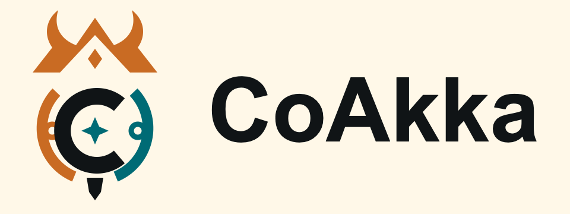
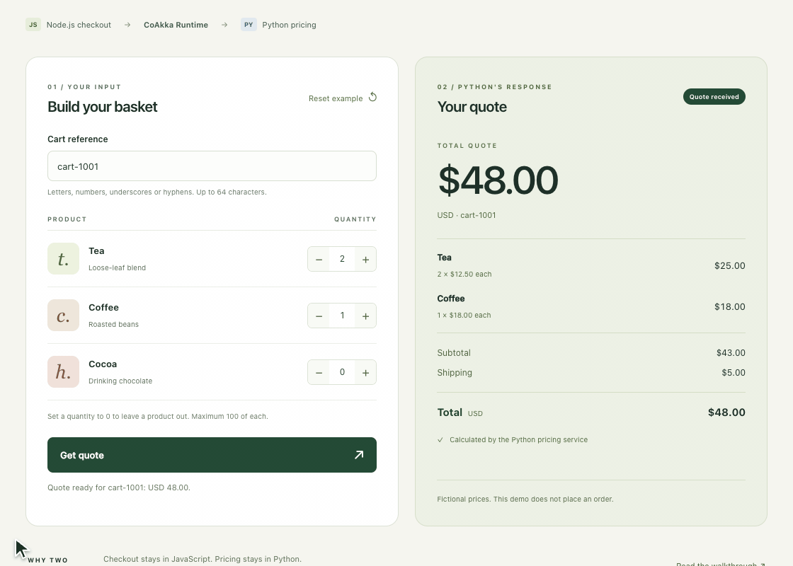

# CoAkka Publish

[Website](https://coakka-ecosystem-preview.vivid-plume-2955.chatgpt.site/) · [Find a package](#choose-your-product) · [Demo](#try-the-nodepython-web-demo) · [Runtime tools](#coakka-runtime-client-and-inspect) · [Documentation](docs/README.md)

**Shared native cores. Familiar APIs across languages.**

CoAkka is a **polyglot, cross-platform ecosystem** built on shared native cores.
**CoAkka Runtime** is a **native-backed distributed runtime for
application-owned work** across languages, processes and hosts. Your application
keeps its handlers, business rules and data.

Use **HTTP Runtime** for HTTP services and **Logger** for logging with bounded
storage. Each product can be adopted independently and has its own packages
and versions.

**[Find a package by product and language](#choose-your-product)**

## Try the Node–Python web demo

Build a basket in your browser. Node.js sends it to a separate Python process,
which returns item prices, shipping and the total through CoAkka Runtime.

**[Run the demo and read the walkthrough](https://github.com/phuong-tran/coakka-samples/blob/main/coakka-runtime/scenarios/order-quote-node-python/README.md)** · Published npm/PyPI **3.0.0** packages · Two terminals, no Docker required.

Change the quantities, request a quote and see Python return the updated total.
[View a still screenshot](docs/coakka-runtime/assets/node-python-order-quote-web.png).

## Choose your product

| I need… | First steps | Package catalog |
| --- | --- | --- |
| Calls between application work across processes or languages | [Runtime in my language](docs/coakka-runtime/getting-started.md) | [Runtime packages](coakka-runtime/README.md) |
| An HTTP API, web frontend or streaming endpoint | [HTTP Runtime in my language](docs/coakka-http-runtime/getting-started.md) | [HTTP archives](coakka-http-runtime/README.md) |
| Application logging and visible pressure | [Logger in my language](docs/coakka-logger/README.md#start-with-one-consumer) | [Logger packages](coakka-logger/README.md) |

## CoAkka Runtime: languages, frameworks and app hosts

CoAkka Runtime brings application-owned work to backend, desktop and device
applications. Choose the integration that matches your code:

| Application language or host | Start here |
| --- | --- |
| JavaScript / TypeScript on Node.js and Bun; Python; Java and Kotlin; C#; Go; Swift | [Language-first Runtime examples](https://github.com/phuong-tran/coakka-samples/blob/main/coakka-runtime/README.md#first-run-choose-your-language) |
| Spring Boot and Quarkus | [Framework customer applications](https://github.com/phuong-tran/coakka-samples/blob/main/coakka-runtime/scenarios/customer-crud/framework-registry/README.md) |
| Electron and Tauri desktop apps | [Electron](https://github.com/phuong-tran/coakka-samples/blob/main/coakka-runtime/electron/registry-basic/README.md) · [Tauri](https://github.com/phuong-tran/coakka-samples/blob/main/coakka-runtime/tauri/README.md) |
| C / C++, Rust, Zig, Android and Mojo | [Source/archive guides and previews](https://github.com/phuong-tran/coakka-samples/blob/main/coakka-runtime/README.md#other-languages-and-evaluations) |

Released 3.0.0 first runs cover Node.js, Bun, Python, Java/Kotlin, C#, Go,
Swift, Electron, Spring Boot and Quarkus. Tauri, C/C++, Rust and Zig follow their own versioned
source/archive guides; Android and Mojo are previews. Each guide gives its
actual package and platform scope.

## CoAkka Runtime Client and Inspect

Use the companion tools to try Runtime before writing another application,
or to check a request while integrating it.

| Tool | Use it for |
| --- | --- |
| [CoAkka Runtime Client](docs/coakka-runtime/operations/coakka-runtime-client.md) — `coakka-runtime-client` | Send test requests from a terminal or script and inspect the returned result. |
| [CoAkka Runtime Inspect](docs/coakka-runtime/operations/coakka-runtime-inspect.md) — `coakka-runtime-inspect` | Explore Runtime facts and try request/reply interactions in a browser. |

These are the product names. The released Client command is `coakka-client`;
the Inspect command is `coakka-runtime-inspect`. Follow each tool's guide for
its published version, connection setup and inspection scope.

## CoAkka HTTP Runtime: shared HTTP, familiar languages

**CoAkka HTTP Runtime** (`coakka-http-runtime`) provides an HTTP server and
client for polyglot applications. Use it for APIs, web frontends, uploads,
files, streaming and WebSocket services.

Its language packages share one native HTTP core. Common HTTP behavior and
fixes can reach several languages through updated packages, while each service
keeps its own handlers and business rules. Teams can reuse their understanding
of HTTP across services instead of maintaining unrelated HTTP behavior for
every application language.

HTTP Runtime serves the HTTP edge; CoAkka Runtime connects named application
work. An HTTP handler can call Runtime when it needs that work, and either
product can also be adopted independently.

**Package-manager releases are in preparation for npm, Maven Central, Go
modules and PyPI.** The current installation path uses 1.0.0 repository archives.
Start with the [HTTP language guides](docs/coakka-http-runtime/getting-started.md)
and [current archive catalog](coakka-http-runtime/README.md).

## Trying CoAkka for the first time?

Use [Samples](https://github.com/phuong-tran/coakka-samples) to run a small
application in your language. Follow its complete prerequisites, command and
expected result. The normal Runtime connector package supplies its required
Runtime components.

The [package ledger](docs/common/current-packages.md) records exact released
coordinates. [New to CoAkka](docs/common/new-to-coakka.md) explains which product
fits your application.

## Downloading an archive or checking a release?

Use the selected product catalog to choose the exact version and platform.
Follow its manifest, checksum and platform-evidence instructions. Local
evaluation packages are separate from published registry coordinates.

Versioned downloads, Maven paths, source mirrors and receipts retain their
original URLs and bytes. [Product layout](docs/common/product-layout.md)
explains the warehouse and rolling documentation. This repository has no
aggregate product version or aggregate GitHub Release.

[All documentation](docs/README.md) ·
[Runtime platform requirements](docs/coakka-runtime/reference/runtime-package-platform-evidence.md) ·
[Artifact contract](docs/common/public-artifact-contract.md) ·
[Support](SUPPORT.md) · [Changelog](CHANGELOG.md)

Contact: gabrielgun1983@gmail.com
