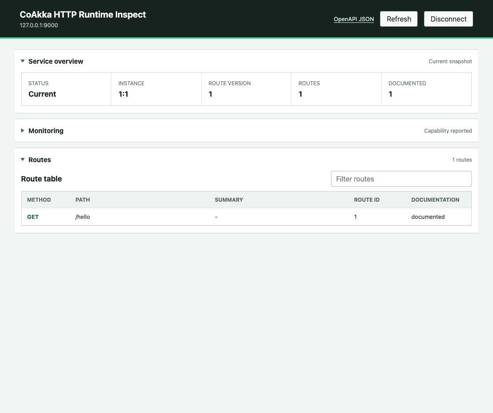
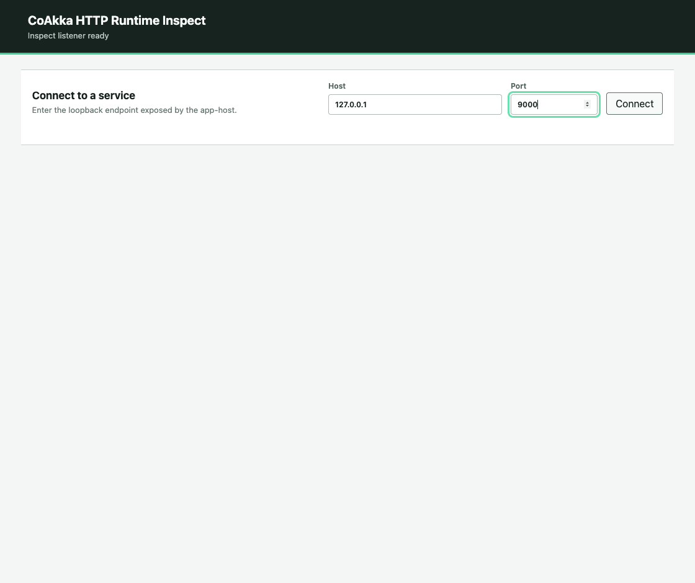

# HTTP Runtime Inspect walkthrough

Inspect is a standalone, Swagger-like browser for local development. Connect
it to an inspection-enabled service to browse declared routes, send a real
request and export an OpenAPI 3.0.3 document.

This walkthrough uses the standalone Inspect **1.0.0** macOS ARM64 archive and
the **1.1.2** Node.js connector. The native consumer tests below use the
**1.1.2** SDK. Run the commands from a checkout of
[coakka-publish](https://github.com/phuong-tran/coakka-publish).



## Start a documented service

Use Node.js and npm on macOS ARM64. In the first terminal, create a fresh
directory for the demo, install the connector and generate a local bearer file.

```sh
PUBLISH="$PWD"
WORK="$(mktemp -d)"
cd "$WORK"
npm install coakka-http-runtime-node@1.1.2
(umask 077; openssl rand -hex 32 | tr -d '\n' > inspect.token)
printf 'Demo directory: %s\n' "$WORK"
```

Save the following as `inspect-demo.mjs` in that directory.

```js
import { resolve } from "node:path";
import { ApiSchemaKind, Builder, Response, RouteApiMetadata } from "coakka-http-runtime-node";

const bearerFile = process.argv[2];
if (!bearerFile) throw new Error("Pass the path to the inspection bearer file");

const apiMetadata = new RouteApiMetadata({
  operationId: "hello.read",
  summary: "Read a greeting",
  responses: [{
    status: 200,
    description: "Greeting returned",
    content: [{ mediaType: "text/plain", schema: { kind: ApiSchemaKind.STRING } }],
  }],
});

const service = new Builder()
  .listen("127.0.0.1", 9000)
  .inspection({
    runtimeInstanceId: 1n,
    runtimeGeneration: 1n,
    bearerFile: resolve(bearerFile),
    allowPlaintextLoopback: true,
  })
  .get("/hello", () => Response.text("hello"), { apiMetadata })
  .start();

try {
  console.log(`Service ready at http://127.0.0.1:${service.port}/hello`);
  await new Promise((done) => {
    process.once("SIGINT", done);
    process.once("SIGTERM", done);
  });
} finally {
  await service.close();
}
```

```sh
node inspect-demo.mjs "$WORK/inspect.token"
```

The service binds to `127.0.0.1:9000`. Keep this terminal running. Use the
bearer file only for this local demo and keep both listeners on loopback.

## Connect, send a request and export OpenAPI

In a second terminal, set `PUBLISH` to the absolute checkout path and `WORK`
to the demo directory printed above. Verify the macOS archive, then start
Inspect with the same bearer file.

```sh
ARCHIVE=coakka-http-runtime-inspect-1.0.0-macos-aarch64.tar.gz
ARCHIVES="$PUBLISH/coakka-http-runtime/inspect/candidates/2026-10-08"
(cd "$ARCHIVES" && grep "  $ARCHIVE\$" SHA256SUMS | shasum -a 256 -c)
mkdir "$WORK/inspect"
tar -xzf "$ARCHIVES/$ARCHIVE" -C "$WORK/inspect"
"$WORK/inspect/bin/coakka-http-runtime-inspect" serve \
  --bearer-file "$WORK/inspect.token" \
  --listen-host 127.0.0.1 --listen-port 8080 --timeout-ms 3000
```

1. Open `http://127.0.0.1:8080`. Enter `127.0.0.1` and port `9000`, then click **Connect**.
2. Select **GET /hello** in the route table. Inspect shows the response schema declared by the app.
3. Keep **Origin target** set to `/hello` and click **Send request**. Expect **Target HTTP 200** and body bytes `68656c6c6f` (UTF-8 `hello`).
4. Click **OpenAPI JSON** in the page header to view or save the document. The exported `paths` contains `/hello`. You can import the JSON into a local Swagger UI instance.



If connection fails, check that the target is running on port 9000 and that
both processes read the same bearer file. Stop both processes with Ctrl-C
and remove the demo directory when finished.

## Build and test against the native SDK

Install CMake and a matching Apple compiler and linker. From a checkout of
[coakka-samples](https://github.com/phuong-tran/coakka-samples), set
`PUBLISH` to the absolute path of your publish checkout. Use a fresh build
directory on a writable volume. The archive filename below is the one listed
in the [1.1.2 SDK downloads](../native/releases/1.1.2/).

```sh
BUILD_ROOT=/absolute/path/to/a/writable/build-directory
SDK_ARCHIVES="$PUBLISH/coakka-http-runtime/native/releases/1.1.2"
SDK_ARCHIVE=coakka-http-host-1.1.2-candidate-macos-aarch64.tar.gz
(cd "$SDK_ARCHIVES" && grep "  $SDK_ARCHIVE\$" SHA256SUMS | shasum -a 256 -c)
mkdir -p "$BUILD_ROOT/sdk"
tar -xzf "$SDK_ARCHIVES/$SDK_ARCHIVE" -C "$BUILD_ROOT/sdk"
cmake -S coakka-http-runtime/runtime-test -B "$BUILD_ROOT/http-tests" \
  -DCMAKE_PREFIX_PATH="$BUILD_ROOT/sdk" \
  -DCMAKE_OSX_SYSROOT="$(xcrun --sdk macosx --show-sdk-path)" \
  -DCMAKE_BUILD_TYPE=Release
cmake --build "$BUILD_ROOT/http-tests" --config Release --parallel
ctest --test-dir "$BUILD_ROOT/http-tests" -C Release --output-on-failure
```

The documented macOS ARM64 run passed **13/13 tests** against the released SDK.
If CMake reports a linker error about the macOS SDK, confirm that `xcode-select -p`
and `xcrun --sdk macosx --show-sdk-path` refer to the same toolchain, then configure
in a fresh build directory.
